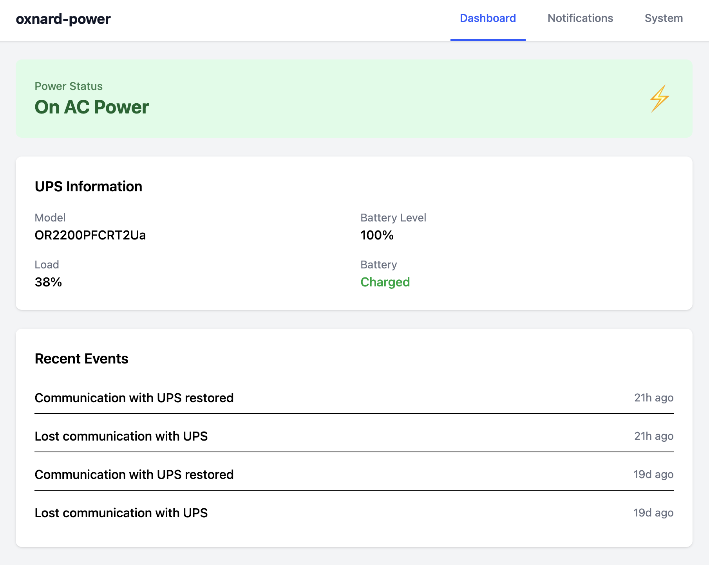

# PiPower

**Instant power outage alerts for your critical infrastructure.**

PiPower is a turnkey Raspberry Pi appliance that monitors your UPS via [NUT (Network UPS Tools)](https://networkupstools.org/) and sends email and SMS notifications when power events occur. Know about outages the moment they happen, before batteries run out.

## Why PiPower?

Power outages at remote sites go unnoticed until it's too late. By the time you discover the UPS battery is drained, your servers are already down and you're scrambling to respond.

PiPower watches your UPS 24/7 and alerts you within seconds of a power event (loss, restoration, low battery, and critical runtime), giving you time to act. It's self-hosted, open source, and has zero recurring costs.

### Features

- **Instant notifications** - Email and SMS alerts for power loss, restoration, low battery, and critical runtime
- **Web dashboard** - Real-time battery level, load percentage, power status, and event history
- **Health check endpoint** - Returns 200 on AC power, 503 on battery. Integrates with Uptime Robot, Pingdom, etc.
- **Remote access** - Optional [Raspberry Pi Connect](https://connect.raspberrypi.com) integration for remote shell access from anywhere
- **Self-updating** - Check for and apply updates from the web UI or CLI
- **Zero maintenance** - Runs silently in the background, no cloud dependencies, no subscriptions



### Use Cases

- Server rooms and network closets
- Point of sale systems
- Medical and lab equipment
- Home labs and NAS setups
- Any site with a USB UPS that needs monitoring

## Requirements

- Raspberry Pi 3/4/5 (or Zero 2 W)
- 16GB or larger SD card
- USB-connected UPS ([NUT compatible](https://networkupstools.org/stable-hcl.html))
- Ethernet connection

## Getting Started

### Build the Image (One-Time)

First, create a distributable SD card image. This is a one-time process. Once built, the same image can be flashed to as many SD cards as needed.

See [BUILDING.md](BUILDING.md) for complete instructions.

### Deploy

#### Step 1: Flash the Image

1. Locate your `pipower-dist.img.xz` file
2. Flash it to a **16GB or larger** SD card using [Raspberry Pi Imager](https://www.raspberrypi.com/software/) (it handles .xz decompression automatically)

#### Step 2: Set First-Boot IP (Optional)

The image boots with the IP address set during the build (default **192.168.100.40**). If your network can't reach that address, override it by editing `cmdline.txt` on the bootfs partition before first boot:

1. Open `cmdline.txt` on the bootfs partition
2. Find the `ip=` parameter (after `rootwait`) and change the address, gateway, and netmask:
   ```
   ip=192.168.1.100::192.168.1.1:255.255.255.0:rpi:eth0:off
   ```
   Format: `ip=<address>::<gateway>:<netmask>:rpi:eth0:off`

This is only a temporary override to make the device reachable. The permanent network configuration is set during deploy (Step 3).

#### Step 3: Boot and Deploy

1. Insert SD card into Raspberry Pi
2. Connect UPS via USB
3. Connect Ethernet cable
4. Power on and wait ~60 seconds for boot
5. SSH into the device:
   ```bash
   ssh pi@192.168.100.40   # or the IP you set in cmdline.txt
   ```
   Password: `raspberry`

6. Run the deploy command:
   ```bash
   pa power:deploy
   ```

7. Enter the hostname when prompted (e.g., `Oxnard-Power`)
8. The command detects your current IP and gateway, then asks if you want to change them. Enter the permanent static IP, gateway, and netmask for this device:
   ```
   Detected IP: 192.168.100.40 (Gateway: 192.168.100.1)

   Change network settings? (yes/no) [yes]: yes
   Static IP: 192.168.1.100
   Gateway: 192.168.1.1
   Netmask: 255.255.255.0
   ```

The deploy command configures NetworkManager with your hostname and network settings, removes the temporary `cmdline.txt` IP override, updates to the latest version, and reboots. After reboot, access the web interface at `http://<ip-address>` to manage notifications and monitor power status.

#### Step 4: Set Up Raspberry Pi Connect (Optional)

After the device reboots, you can enable [Raspberry Pi Connect](https://connect.raspberrypi.com) for remote shell access from anywhere.

1. Create an auth key at [connect.raspberrypi.com](https://connect.raspberrypi.com) → **Settings** → **Auth keys** → **New**
2. Run the setup command or use the web UI:

**Via CLI** (SSH into the device):
```bash
pa power:rpi-connect
```

**Via Web UI**: Navigate to the **System** page and use the Raspberry Pi Connect section.

**Changing settings later:** Use the web interface **System** page to update hostname, IP address, or check for updates.

## CLI Commands

On a deployed device, use the `pa` alias:

```bash
pa power:status        # Check UPS status
pa power:health        # Health check (NUT daemon + UPS connectivity)
pa power:notify-test   # Test notifications
pa power:deploy        # Configure hostname, network, and update
pa power:update        # Check for and apply updates
```

The `pa` alias runs artisan in the installed app (`/var/www/pipower`). Running `php artisan` inside the `~/PiPower` source checkout fails because its dependencies are only installed in `/var/www/pipower`.

To update manually over SSH, run the update script from the source checkout:

```bash
cd ~/PiPower && sudo ./update.sh
```

During development, use `php artisan` directly.

## API Endpoints

| Endpoint | Method | Description |
|----------|--------|-------------|
| `/api/health` | GET | Health check (returns 200/503) |
| `/api/status` | GET | Full UPS and power status |
| `/api/events` | GET | Recent power events |
| `/api/recipients` | GET/POST | Notification recipients |
| `/api/recipients/{id}` | PUT/DELETE | Manage recipient |
| `/api/settings` | GET/PUT | System settings |
| `/api/network/status` | GET | Network connection status |
| `/api/network/apply-and-reboot` | POST | Apply network settings and reboot |
| `/api/notifications/test` | POST | Send a test notification |
| `/api/update/check` | GET | Check for available updates |
| `/api/update/status` | GET | Current update status |
| `/api/update/apply` | POST | Apply available update |
| `/api/system/reboot` | POST | Reboot the Raspberry Pi |
| `/api/system/shutdown` | POST | Shut down the Raspberry Pi |
| `/api/pi-connect/status` | GET | Raspberry Pi Connect status |
| `/api/pi-connect/signin` | POST | Sign in to Pi Connect |
| `/api/pi-connect/signout` | POST | Sign out of Pi Connect |

### Response Examples

**`GET /api/health`** - Returns 200 when healthy, 503 when there's a power issue:

```json
{"status": "ok", "message": "System healthy"}
```

**`GET /api/status`** - Full system status:

```json
{
  "power": {
    "status": "on_mains",
    "on_battery_since": null
  },
  "ups": {
    "connected": true,
    "model": "CyberPower CP1500AVRLCD",
    "battery_level": 100,
    "battery_low": false,
    "battery_runtime": 5400,
    "charging": false,
    "load_percent": 12,
    "on_battery": false
  },
  "device": {
    "hostname": "Oxnard-Power",
    "ip": "192.168.1.100",
    "uptime_seconds": 86400,
    "version": "1.0.0"
  },
  "last_event": {
    "type": "power_restored",
    "timestamp": "2025-01-15T10:30:00+00:00"
  }
}
```

## Configuration

### UPS Configuration

Edit `/etc/nut/ups.conf` to match your UPS. See `provisioning/config/ups.conf.example` for common configurations.

Common USB UPS setup:
```ini
[ups]
    driver = usbhid-ups
    port = auto
    desc = "Main UPS"
```

### Notification Settings

Configure notifications on the web UI's Notifications page or directly in `.env`. Values saved in the UI take precedence over `.env`; the SMTP password and Plivo auth token are encrypted in the database and never shown again after saving.

```env
# Email (SMTP)
MAIL_HOST=smtp.example.com
MAIL_PORT=587
MAIL_USERNAME=your-username
MAIL_PASSWORD=your-password
MAIL_FROM_ADDRESS=pipower@example.com

# SMS (Plivo)
PLIVO_AUTH_ID=your-auth-id
PLIVO_AUTH_TOKEN=your-auth-token
PLIVO_FROM_NUMBER=+18055551234
```

## Architecture

```
┌─────────────────┐     ┌─────────────────┐
│   Raspberry Pi  │     │      UPS        │
│                 │ USB │                 │
│  ┌───────────┐  │◄───►│  Battery/Power  │
│  │    NUT    │  │     │                 │
│  └─────┬─────┘  │     └─────────────────┘
│        │        │
│  ┌─────▼─────┐  │     ┌─────────────────┐
│  │ PowerMon  │  │     │   Notifications │
│  │  Service  │──┼────►│  Email / SMS    │
│  └─────┬─────┘  │     └─────────────────┘
│        │        │
│  ┌─────▼─────┐  │     ┌─────────────────┐
│  │  Web UI   │◄─┼─────│    Browser      │
│  └───────────┘  │     └─────────────────┘
└─────────────────┘
```

## Development

### Prerequisites

- PHP 8.2+ with sqlite3, mbstring, xml, curl extensions
- Composer
- Node.js 20+ and pnpm

### Setup

```bash
composer install && pnpm install
cp .env.example .env
php artisan key:generate
touch database/database.sqlite
php artisan migrate
composer run dev
# If using Laravel Valet (macOS): http://power.test
# Otherwise, in a separate terminal: php artisan serve → http://localhost:8000
```

### Testing

```bash
php artisan test
php artisan test --coverage
```

## Tech Stack

- **Backend**: Laravel 12, PHP 8.2
- **Frontend**: Vue.js 3, Vue Router 4, Tailwind CSS 4
- **Database**: SQLite
- **UPS**: NUT (Network UPS Tools)
- **Notifications**: SMTP email, Plivo SMS
- **Testing**: Pest (PHP)
- **Build**: Vite, pnpm

## License

MIT License - see [LICENSE](LICENSE) file for details.

## Contributing

Contributions are welcome! Please read [CONTRIBUTING.md](CONTRIBUTING.md) for guidelines.
